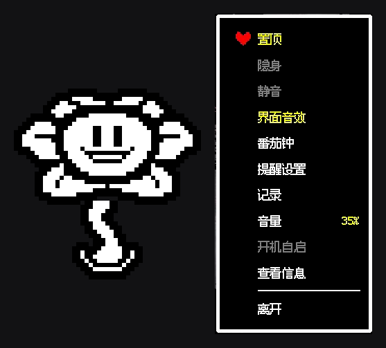
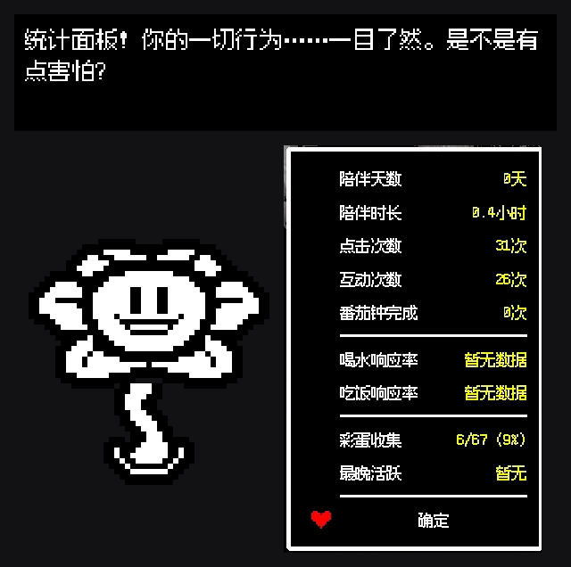
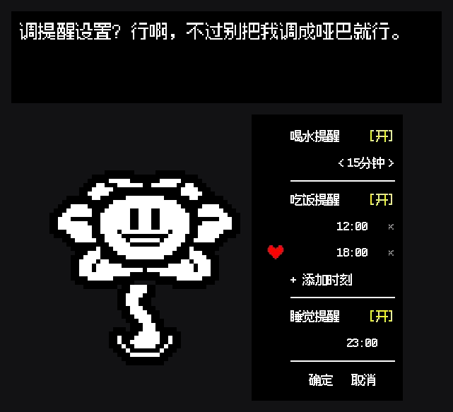

<p align="center">
  
</p>

<h1 align="center">FloweyPet</h1>

<p align="center">
  A Windows desktop pet starring Flowey from <i>Undertale</i> — built with Python + PyQt6.
</p>

<p align="center">
  <a href="LICENSE"></a>
  
</p>

<p align="center">
  <b><a href="#中文">中文</a></b> ・ <b><a href="#english">English</a></b>
</p>

---

## 中文

### 这是什么

FloweyPet 是一只住在你 Windows 桌面上的、话很多的 Flowey（《传说之下 / Undertale》）。点它、拖它，它会理你——有几百句手写台词、会记住你们的"关系进展"（连续陪伴天数、冷落、重逢等），还有点实际用途：内置番茄钟和喝水/吃饭/睡觉提醒，毕竟连 Flowey 都不想看你忘记喝水。

这是一个非官方的粉丝作品。Flowey 及原作角色、美术、音效的版权归 Toby Fox /《Undertale》所有。本仓库开源的是**代码**部分，非商业用途，详见下方[鸣谢与免责声明](#鸣谢与免责声明)。

### 功能

- **桌面陪伴**：可拖拽的桌宠，置顶开关，点击反应，待机动画（可关闭，改为静止）
- **Undertale 战斗菜单**：右键菜单仿照游戏的「战斗 / 行动 / 物品 / 存档点 / 仁慈」，点进分类再选具体功能
- **锁定**：锁定后鼠标直接穿透小花，玩游戏、看视频时不会误点；右键菜单和托盘都能锁定和解锁
- **窗口化游戏也能置顶**：开着置顶时，小花会一直待在窗口化游戏上面
- **大小调节**：7 档缩放（200 / 150 / 125 / 100 / 75 / 50 / 25%），都是整数倍，小花和对话框一起缩放；改大小后小花不会跑到屏幕外
- **调情系统**：专门的"调情"互动，带隐藏彩蛋，自己去发现吧
- **数百句台词**：登场、待机闲聊、点击反应、菜单台词、隐藏彩蛋，全部写在 `dialogue*.json` 里，改台词不用碰代码
- **番茄钟**：专注/休息时长可调，小花身上直接显示倒计时
- **会追讨的提醒**：喝水/吃饭/睡觉提醒，你要是只划掉不理它，它会分阶段继续追问
- **"记录"面板**：陪伴天数、点击/互动/调情次数、彩蛋收集进度
- **游戏彩蛋**：检测到你打开 UNDERTALE / DELTARUNE 时会说话（只看进程名）
- **一键更新**：有新版本时小花会告诉你，托盘里会出现"更新到 vX"，点一下就会自动下载、校验、替换并重启（从 3.3.0 起可用，见[升级到 3.3.0 与一键更新](#升级到-330-与一键更新)）
- **换版本不丢记录**：从 3.2.0 开始，设置和记录存放在固定位置，以后升级不用再手动搬

### 3.3.0 更新内容

- **一键自动更新**：托盘里出现"更新到 vX"时点一下，后台下载更新包、校验、替换程序文件并重启；任何一步失败都会保持旧版可用（下载、校验或解压失败时打开下载页，替换中途失败会自动回滚到旧版）
- **大小改为 7 档整数倍**：200 / 150 / 125 / 100 / 75 / 50 / 25%，旧设置会自动吸附到最近的一档；改大小后小花会被夹回屏幕内
- **不再跟随 Windows 的小数缩放**（125%、150% 等）：修复像素字体在这些缩放下被切掉的问题，包括"记录"面板里的字被切
- **新的调情台词**：分层改为 1 / 2-25 / 26-70 / 71+，第四档会显示真实的调情次数。**3.3.0 起调情次数清零一次**
- **新增更新相关的台词**：下载、更新中、更新完成、更新失败等
- **修复反作弊误判"篡改"**：以前正常玩很久以后，点击数可能被误判成"被改过"并被打回旧数字；现在每次点击都会同步备份，老用户升级后会自动对齐一次

### 截图

<p align="center">
  <br>
  <sub>右键菜单</sub>
</p>

<p align="center">
  <br>
  <sub>"记录"面板</sub>
</p>

<p align="center">
  <br>
  <sub>提醒设置面板</sub>
</p>

### 系统要求

- Windows 10 / 11，64 位
- 打包好的版本不需要安装 Python 或任何运行环境
- 只有从源码运行时才需要 Python 3.9+（见[从源码运行](#从源码运行)）

### 下载使用

1. 在 [Releases 页面](../../releases/latest)下载最新的 zip。
2. 解压到任意位置。
3. 双击 `FloweyPet.exe`。

右键点小花打开菜单，右键托盘图标也有常用功能。

### 从旧版本升级（3.1.1 及更早）

旧版本把设置和记录（`config.json`、`stats.json`）放在 exe 旁边，3.2.0 开始改放到固定位置。新版第一次打开时会自动把旧记录搬过去，前提是它能找到旧文件：

- **方法一：解压覆盖。** 先从托盘退出旧版小花，再把新版解压到旧版所在的文件夹里覆盖。打开后记录自动搬好。
- **方法二：解压到新文件夹。**
  - 如果旧版开着"开机自启"，新版会顺着它找到旧文件夹，自动搬好。
  - 如果没开，把旧文件夹里的 `config.json` 和 `stats.json` 复制到新版 `FloweyPet.exe` 旁边，再打开小花。已经先打开过也没关系：退出小花、放好文件、重新打开就行，这期间产生的新记录会先自动备份一份。

旧文件只会被复制，不会被删除或修改。这次升级之后，以后的新版本就不需要再手动做任何事了。

旧版本还会在 `C:\FloweyPet\` 里写日志，换上新版后这个文件夹可以直接删掉。

### 升级到 3.3.0 与一键更新

- **从 3.2.0 升到 3.3.0 需要手动下载一次**：3.2.0 还没有一键更新。在 [Releases 页面](../../releases/latest)下载新版 zip，退出旧版小花后解压覆盖，或解压到新文件夹都行；设置和记录在 `%APPDATA%\FloweyPet`，不会丢。
- **从 3.3.0 起**：托盘出现"更新到 vX"时点一下即可。小花会在后台下载更新包，用 `version.json` 里的 SHA256 和大小校验，通过后才退出并替换程序文件，然后自动重新打开新版。
- **失败了怎么办**：下载、校验或解压失败时，会保持当前版本不动并打开下载页，你可以手动更新；替换文件中途出错或被打断（比如断电），会自动回滚到旧版。
- **安装位置**：建议不要把小花装在 `Program Files` 这类需要管理员权限的文件夹里，否则小花没有权限替换自己，"更新到 vX"只会打开下载页，需要手动更新。放在桌面、文档或自己建的文件夹里就可以。

### 杀毒软件误报

打包好的 exe 是用 PyInstaller 做的，没有数字签名，少数杀毒软件可能会误报。所有代码都在这个仓库里公开，可以自己检查；不放心的话也可以[从源码运行](#从源码运行)。

### 联网与隐私

- 小花的联网行为有两种：
  - **检查更新**：定期读取本仓库里一个公开的 `version.json`，看有没有新版本。请求里除了版本号不带任何信息。
  - **一键更新**：只有你点了托盘里的"更新到 vX"才会发生。小花会从本仓库的 GitHub Releases 下载更新包，用 `version.json` 里的 SHA256 和大小校验完整性，通过后才会替换程序文件。你不点，就不会下载，也不会替换任何东西。
- 不上传任何数据。
- 更新时会在安装目录里留下 `.update_backup`（上一版的备份）和 `.install_manifest.json`（本次安装的文件清单）。你的设置和记录存放在 `%APPDATA%\FloweyPet`，更新不会碰它。
- 不想联网的话，在右键菜单「存档点 → 检查更新」里关掉即可。
- 游戏彩蛋只在本机读取正在运行的**进程名**，不读窗口标题、窗口内容，也不截图。

### 数据存放在哪

| 内容 | 位置 |
|---|---|
| 设置、记录 | `%APPDATA%\FloweyPet\`（`config.json`、`stats.json`） |
| 日志 | `%APPDATA%\FloweyPet\logs\`（更新过程记在 `update.log`） |
| 更新备份和安装清单 | 安装目录里的 `.update_backup\`、`.install_manifest.json` |
| 开机自启 | 注册表 `HKCU\Software\Microsoft\Windows\CurrentVersion\Run` 下的 `FloweyPet` |
| 反作弊用的点击数备份 | 注册表 `HKCU\Software\FloweyPet` |

想彻底重置，退出小花后删掉 `%APPDATA%\FloweyPet` 文件夹即可。

### 从源码运行

环境要求：Python 3.9+，Windows。

```powershell
pip install -r requirements.txt
python main.py
```

从源码运行时，设置和记录放在仓库里的 `dev_data/` 文件夹（已被 git 忽略），不会影响打包版的数据。

运行测试：

```powershell
python tools/run_tests_isolated.py
```

### 打包

```powershell
python -m PyInstaller FloweyPet.spec --noconfirm
```

产物在 `dist\FloweyPet\`。台词 JSON 已经写在 spec 里，会自动放到 exe 旁边，不需要手动复制。

### 目录结构

```
src/               应用代码（台词引擎、番茄钟、提醒、界面、更新检查……）
assets/            美术素材、字体、音效
dialogue*.json     台词（打包后在 exe 旁边，可以直接改）
stats_roast.json   "记录"面板的吐槽台词
main.py            程序入口
FloweyPet.spec     打包配置
tools/             测试运行脚本
```

### 鸣谢与免责声明

- 《Undertale》与 Flowey 由 Toby Fox 创作。本项目是非官方粉丝作品，与 Toby Fox 无关，也未获得其背书。
- 角色美术与部分音效改编自《Undertale》原作，仅用于本粉丝项目，版权归原作者所有。
- 菜单音效来自《Undertale》同人免费素材包，感谢为《Undertale》为爱发电的同人创作者们，感谢b站用户事牢梓喵提供select音频和存档音频。
- 字体：
  - [Fusion Pixel](https://github.com/TakWolf/fusion-pixel-font)，作者 TakWolf，SIL Open Font License 1.1，许可证见 `assets/fonts/FUSION-PIXEL-LICENSE.txt`
  - [DSEG7](https://github.com/keshikan/DSEG)，作者 keshikan，SIL Open Font License 1.1，许可证见 `assets/font/DSEG-LICENSE.txt`
- 本仓库的**代码**以 MIT 协议开源（见 [LICENSE](LICENSE)），但这不代表对《Undertale》角色、美术、音效的任何授权。请不要将这些素材用于商业用途。

---

## English

### What is this

FloweyPet is a small, chatty Flowey (from *Undertale*) who lives on your Windows desktop. Click him, drag him around, and he'll talk back — with hundreds of hand-written lines, a relationship that evolves with you (streaks, neglect, reunions), and a genuinely useful side: a Pomodoro timer and water/meal/sleep reminders.

This is an unofficial fan project. Flowey and all original characters, art and sounds belong to Toby Fox / *Undertale*. This repository releases the **code** under an open-source license for non-commercial use — see [Credits & disclaimer](#credits--disclaimer).

### Features

- **Desktop companion** — draggable pet, always-on-top toggle, click reactions, idle animation (can be switched to a still frame)
- **Undertale battle menu** — the right-click menu follows the game's FIGHT / ACT / ITEM / SAVE / MERCY layout
- **Lock** — makes Flowey click-through so you can't hit him by accident while gaming or watching videos; lock/unlock from the right-click menu or the tray
- **Stays above windowed games** when always-on-top is on
- **Size tiers** — 200 / 150 / 125 / 100 / 75 / 50 / 25% (whole-number steps), pet and dialogue bubble scale together; resizing keeps Flowey on screen
- **Flirt system** — a dedicated interaction with hidden easter eggs
- **Hundreds of lines** — all in `dialogue*.json`, editable without touching code
- **Pomodoro timer** with an on-pet countdown
- **Reminders that follow up** if you dismiss them without responding
- **Stats panel** — days together, clicks, interactions, easter-egg progress
- **Game easter eggs** — reacts when UNDERTALE / DELTARUNE starts (process name only)
- **One-click update** — Flowey tells you when a new version is out, and the tray gets an "Update to vX" entry that downloads, verifies, replaces and restarts for you (from 3.3.0 on; see [Upgrading to 3.3.0 and one-click update](#upgrading-to-330-and-one-click-update))
- **Data survives upgrades** — from 3.2.0 on, settings and stats live in a fixed folder

### What's new in 3.3.0

- **One-click update** — click "Update to vX" in the tray: the package is downloaded in the background, verified, the program files are replaced and the new version starts. Any failure leaves a working version behind (a failed download / verification / unpack opens the download page; a failure while replacing files rolls back to the old version automatically)
- **7 size tiers in whole-number steps** — 200 / 150 / 125 / 100 / 75 / 50 / 25%; old settings snap to the nearest tier, and Flowey is kept on screen after a resize
- **No longer follows Windows' fractional display scaling** (125%, 150% ...) — fixes the pixel font being cut off at those scales, including the text in the stats panel
- **New flirt lines** — tiers are now 1 / 2-25 / 26-70 / 71+, and the top tier shows your real flirt count. **The flirt counter is reset once in 3.3.0**
- **New update-related lines** — downloading, updating, done, failed
- **Fixed the anti-cheat wrongly flagging "tampering"** — after long normal use the click count could be mistaken for an edited save and reset; the backup now follows every click, and existing users are aligned once on upgrade

### Screenshots

See the [中文](#截图) section above.

### System requirements

- Windows 10 / 11, 64-bit
- The packaged build needs no Python or runtime install
- Python 3.9+ only if you run from source

### Download

1. Get the latest zip from the [Releases page](../../releases/latest).
2. Extract it anywhere.
3. Run `FloweyPet.exe`.

### Upgrading from 3.1.1 or earlier

Older versions kept `config.json` and `stats.json` next to the exe; 3.2.0 moves them to a fixed folder and migrates them automatically on first launch, as long as it can find them:

- **Extract over the old folder** (quit the old Flowey from the tray first). Done.
- **Extract to a new folder.** If the old version had autostart on, the new one follows that entry and finds the old folder by itself. Otherwise, copy `config.json` and `stats.json` from the old folder next to the new `FloweyPet.exe` and start Flowey again. If you already launched the new version once, quit it, drop the files in, and relaunch; anything recorded in between is backed up first.

Old files are only copied, never moved or changed. After this one upgrade, future versions need no manual steps. The old `C:\FloweyPet\` log folder can be deleted.

### Upgrading to 3.3.0 and one-click update

- **3.2.0 → 3.3.0 needs one manual download**: 3.2.0 has no one-click update yet. Get the new zip from the [Releases page](../../releases/latest), quit Flowey, then extract over the old folder (or into a new one). Your settings and stats live in `%APPDATA%\FloweyPet` and are kept.
- **From 3.3.0 on**: when the tray shows "Update to vX", click it. Flowey downloads the package in the background, checks it against the SHA256 and size in `version.json`, and only then quits, replaces the program files and starts the new version.
- **If something fails**: a failed download, verification or unpack leaves the current version untouched and opens the download page for a manual update; an error or interruption (e.g. power loss) while replacing files is rolled back to the old version automatically.
- **Install location**: don't put Flowey in a folder that needs administrator rights, such as `Program Files` — it can't replace itself there, and "Update to vX" will only open the download page. The desktop, Documents or any folder you created is fine.

### Antivirus false positives

The exe is built with PyInstaller and is not code-signed, so a few antivirus products may flag it. All code is public in this repository; you can also run from source.

### Network & privacy

- There are two kinds of network access:
  - **Update check** — periodically reads one public `version.json` file from this repository. Nothing is sent besides the app version in the request header.
  - **One-click update** — only happens after you click "Update to vX" in the tray. Flowey downloads the update package from this repository's GitHub Releases, checks its integrity against the SHA256 and size in `version.json`, and only then replaces the program files. If you don't click, nothing is downloaded or replaced.
- No data is uploaded.
- An update leaves `.update_backup` (a backup of the previous version) and `.install_manifest.json` (the list of installed files) in the install folder. Your settings and stats live in `%APPDATA%\FloweyPet`, which updates never touch.
- Turn the update check off under right-click menu → SAVE (存档点) → 检查更新.
- Game easter eggs read running **process names** locally — never window titles, window contents or screenshots.

### Where data lives

| What | Where |
|---|---|
| Settings, stats | `%APPDATA%\FloweyPet\` (`config.json`, `stats.json`) |
| Logs | `%APPDATA%\FloweyPet\logs\` (update progress goes to `update.log`) |
| Update backup and install list | `.update_backup\` and `.install_manifest.json` in the install folder |
| Autostart | `FloweyPet` under `HKCU\Software\Microsoft\Windows\CurrentVersion\Run` |
| Anti-cheat click-count backup | `HKCU\Software\FloweyPet` |

To reset everything, quit Flowey and delete `%APPDATA%\FloweyPet`.

### Run from source

```powershell
pip install -r requirements.txt
python main.py
```

Source runs keep their data in `dev_data/` inside the repo (git-ignored), separate from the packaged build.

Run the tests:

```powershell
python tools/run_tests_isolated.py
```

### Build

```powershell
python -m PyInstaller FloweyPet.spec --noconfirm
```

Output goes to `dist\FloweyPet\`. The dialogue JSON files are listed in the spec and land next to the exe automatically.

### Credits & disclaimer

- *Undertale* and Flowey are created by Toby Fox. This is an unofficial fan work, not affiliated with or endorsed by Toby Fox.
- Character art and some sound effects are adapted from *Undertale* for this fan project; all rights remain with the original creator.
- Menu sound effects come from a free *Undertale* fan-made asset pack — thanks to all the fan creators who make things for *Undertale* out of love.Thanks to Bilibili user Shilao Zimiao for providing the select audio and save file audio.
- Fonts:
  - [Fusion Pixel](https://github.com/TakWolf/fusion-pixel-font) by TakWolf, SIL Open Font License 1.1 (`assets/fonts/FUSION-PIXEL-LICENSE.txt`)
  - [DSEG7](https://github.com/keshikan/DSEG) by keshikan, SIL Open Font License 1.1 (`assets/font/DSEG-LICENSE.txt`)
- The **code** is released under the MIT License (see [LICENSE](LICENSE)). This grants no rights to *Undertale*'s characters, art or sounds — please don't use them commercially.
