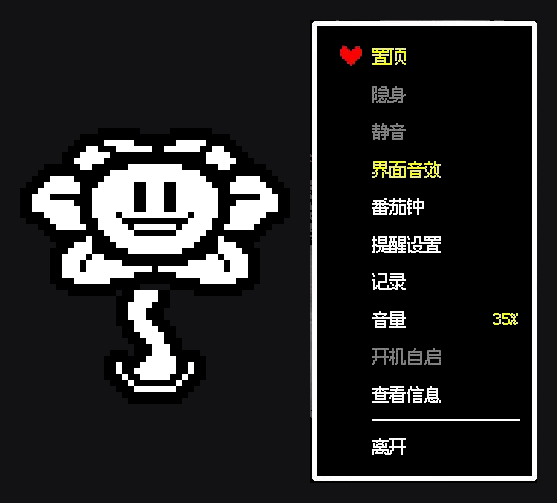
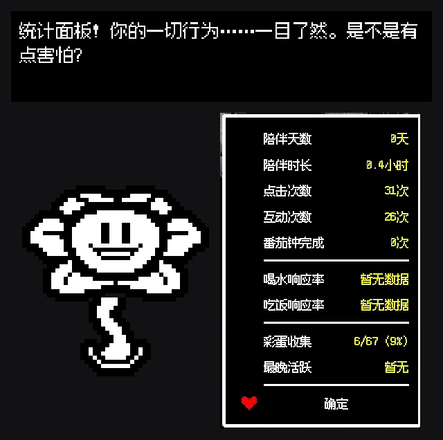
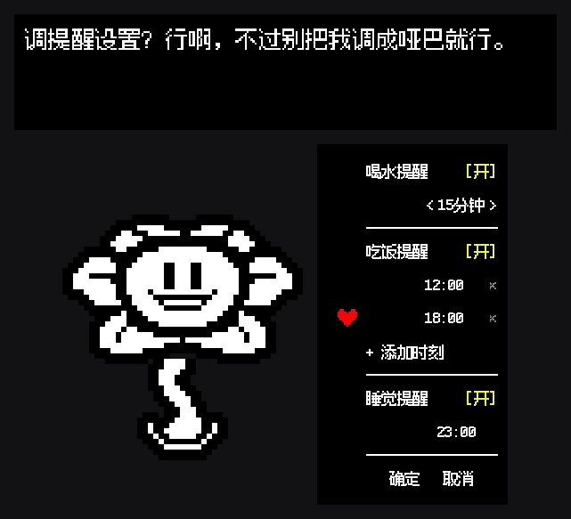

<p align="center">
  
</p>

<h1 align="center">FloweyPet</h1>

<p align="center">
  A Windows desktop pet starring Flowey from <i>Undertale</i> — built with Python + PyQt6.
</p>

<p align="center">
  <a href="LICENSE"></a>
  
</p>

<p align="center">
  <b><a href="#english">English</a></b> ・ <b><a href="#中文">中文</a></b>
</p>

---

## English

### What is this

FloweyPet is a small, chatty Flowey that lives on your Windows desktop. Click him, drag him around, and he'll talk back — with hundreds of hand-written lines, an evolving relationship with you (streaks, neglect, reunions), and a genuinely useful side: a Pomodoro timer and water/meal/sleep reminders, because even Flowey doesn't want you to forget to drink water.

This is a fan project. Flowey and all original character/art concepts belong to Toby Fox / *Undertale*. This repository is a non-commercial, code-focused open-source release — see [Credits & disclaimer](#credits--disclaimer).

### Features

- **Desktop companion** — drag-and-drop pet window, always-on-top toggle, click reactions, idle animations
- **Size adjustment** — 4 size tiers (100/85/70/55%) from the right-click menu, pet and dialogue bubble scale together
- **Flirt system** — a dedicated "调情" interaction with its own hidden easter eggs — go find them yourself
- **Hundreds of dialogue lines** — intro, idle chat, click reactions, menu flavor text, hidden/rare lines, all editable in `dialogue.json` with no code changes needed
- **Pomodoro timer** — configurable focus/break lengths, in-pet countdown display
- **Reminders with follow-up** — water / meal / sleep reminders that actually notice if you dismiss them without responding, with escalating nag stages
- **Stats panel ("记录")** — days accompanied, click/interaction/flirt counts, easter-egg collection progress
- **Undertale-style UI** — right-click menu, volume/size panels, and reminder settings panel all built to look like the game's own dialogue boxes
- **Quality-of-life** — mute/volume control, autostart with Windows, birthday & streak greetings

### Screenshots

<p align="center">
  <br>
  <sub>Undertale-styled right-click menu</sub>
</p>

<p align="center">
  <br>
  <sub>"记录" stats panel</sub>
</p>

<p align="center">
  <br>
  <sub>Reminder settings panel</sub>
</p>

<p align="center">
  <br>
  <sub>Size panel — 4 tiers, new in v2.0</sub>
</p>

<p align="center">
  <br>
  <sub>调情 (flirt) interaction, new in v2.0</sub>
</p>

> **Note (maintainer TODO):** `showcase_size.png` and `showcase_flirt.png` aren't in `docs/images/` yet — need actual screenshots of the size panel and the flirt interaction before these render.

### System requirements

- Windows 10/11, 64-bit
- No Python/runtime install needed for the packaged `.exe` — it's a self-contained PyInstaller build (~45MB unpacked)
- Only needed to *build from source*: Python 3.9+ (see [Run from source](#run-from-source))

### Download (just want to use it)

1. Grab the latest `FloweyPet*.zip` (currently `FloweyPet2.0.zip`) from the [Releases page](../../releases/latest).
2. Extract it anywhere.
3. Run `FloweyPet.exe`. No Python install required.

Right-click the pet for the menu (show/hide, Pomodoro, reminders, volume, size, stats, autostart, quit).

### Run from source

Requirements: Python 3.9+, Windows (uses `winreg` for autostart).

```powershell
pip install -r requirements.txt
python main.py
```

### Build the standalone .exe

```powershell
python -m PyInstaller --name FloweyPet --windowed --onedir --noconfirm `
  --contents-directory "." `
  --icon "<absolute-path>\assets\icon.ico" `
  --paths src `
  --add-data "<absolute-path>\assets;assets" `
  --distpath dist --workpath build --specpath build main.py
```

Then copy `dialogue.json`, `dialogues_info.json`, and `stats_roast.json` into `dist\FloweyPet\` — PyInstaller only bundles what's declared in `--add-data`, and these three files are meant to stay hand-editable next to the exe.

> Note: `--icon` and `--add-data` need **absolute** paths — with `--specpath build`, relative paths resolve against the spec file's own folder, not your shell's working directory.

### Configuration

All user-facing settings live in `config.json` (created automatically on first run, defaults in `src/config.py`): volume, Pomodoro lengths, reminder schedules/intervals, autostart, font scale, and more. Dialogue content lives entirely in `dialogue.json` and is safe to edit without touching any code — see the `_readme` key in that file for the schema.

### Project structure

```
src/            application code (compositor, dialogue engine, pomodoro, reminders, UI...)
assets/         sprites, fonts, sounds
dialogue.json   all dialogue content (editable, no code changes needed)
config.json     user settings (generated on first run)
main.py         entry point
```

### Credits & disclaimer

- *Undertale* and Flowey are created by Toby Fox. This project is an unofficial fan work, not affiliated with or endorsed by Toby Fox.
- Sprites are derived/adapted from *Undertale*'s original character art for this fan project.
- The **code** in this repository is released under the MIT License (see [LICENSE](LICENSE)). This does not grant rights to the underlying *Undertale* characters/IP — please don't use the character art for anything commercial.
- Fonts: "Fusion Pixel" (`assets/fonts/`, SIL Open Font License) and "DSEG7" (`assets/font/`, see its bundled license) for the pixel-style UI text and the Pomodoro digit display.

---

## 中文

### 这是什么

FloweyPet 是一只住在你 Windows 桌面上的、话很多的 Flowey（《传说之下 / Undertale》）。点它、拖它，它会理你——有几百句手写台词、会记住你们的"关系进展"（连续陪伴天数、冷落、重逢等），还有点实际用途：内置番茄钟和喝水/吃饭/睡觉提醒，毕竟连 Flowey 都不想看你忘记喝水。

这是一个粉丝向项目。Flowey 及原作角色/美术概念版权归 Toby Fox / 《Undertale》所有。本仓库开源发布的是**代码**部分，非商业用途，详见下方[鸣谢与免责声明](#鸣谢与免责声明)。

### 功能

- **桌面陪伴** — 可拖拽的桌宠窗口、置顶开关、点击反应、待机动画
- **大小调节** — 右键菜单可选4档缩放（100/85/70/55%），桌宠本体与对话框一起缩放
- **调情系统** — 专门的"调情"互动，带隐藏彩蛋——自己去发现吧
- **数百句台词** — 登场、待机闲聊、点击反应、菜单台词、隐藏/稀有彩蛋台词，全部写在 `dialogue.json` 里，改台词不需要碰代码
- **番茄钟** — 专注/休息时长可配置，桌宠身上直接显示倒计时
- **会追讨的提醒** — 喝水/吃饭/睡觉提醒，如果你只是划掉不理它，它会分阶段继续追问
- **"记录"统计面板** — 陪伴天数、点击/互动/调情次数、彩蛋收集进度
- **Undertale 风格 UI** — 右键菜单、音量/大小面板、提醒设置面板，都仿照游戏本身的对话框样式做的
- **细节体验** — 静音/音量调节、开机自启、生日与连续陪伴天数祝福

### 截图

<p align="center">
  <br>
  <sub>Undertale 风格右键菜单</sub>
</p>

<p align="center">
  <br>
  <sub>"记录"统计面板</sub>
</p>

<p align="center">
  <br>
  <sub>提醒设置面板</sub>
</p>

<p align="center">
  <br>
  <sub>大小面板——4档缩放，v2.0 新增</sub>
</p>

<p align="center">
  <br>
  <sub>调情互动，v2.0 新增</sub>
</p>

> **（维护者待办）** `showcase_size.png` 和 `showcase_flirt.png` 这两张图目前还没放进 `docs/images/`——需要补充大小面板和调情互动的实际截图,上面两张图才会正常显示。

### 系统要求

- Windows 10/11，64位
- 打包好的 `.exe` 无需安装 Python/任何运行环境——是自包含的 PyInstaller 构建（解压后约45MB）
- 只有**从源码构建**时才需要 Python 3.9+（见[从源码运行](#从源码运行)）

### 直接下载使用

1. 在 [Releases 页面](../../releases/latest)下载最新的 `FloweyPet*.zip`（当前版本是 `FloweyPet2.0.zip`）。
2. 解压到任意位置。
3. 运行 `FloweyPet.exe`，不需要装 Python。

右键点击桌宠打开菜单（显示/隐藏、番茄钟、提醒设置、音量、大小、记录、开机自启、离开）。

### 从源码运行

环境要求：Python 3.9+，Windows（开机自启用到了 `winreg`）。

```powershell
pip install -r requirements.txt
python main.py
```

### 打包成 .exe

```powershell
python -m PyInstaller --name FloweyPet --windowed --onedir --noconfirm `
  --contents-directory "." `
  --icon "<绝对路径>\assets\icon.ico" `
  --paths src `
  --add-data "<绝对路径>\assets;assets" `
  --distpath dist --workpath build --specpath build main.py
```

打包完成后，把 `dialogue.json`、`dialogues_info.json`、`stats_roast.json` 三个文件手动复制进 `dist\FloweyPet\` ——PyInstaller 只会打包 `--add-data` 里声明的内容，而这三个文件是特意设计成放在 exe 旁边、可以直接手改的。

> 注意：`--icon` 和 `--add-data` 必须用**绝对路径**——因为指定了 `--specpath build`，相对路径会以 spec 文件所在的 `build` 目录为基准解析，而不是你执行命令时的当前目录。

### 配置

所有用户设置都在 `config.json` 里（首次运行自动生成，默认值见 `src/config.py`）：音量、番茄钟时长、提醒时间/间隔、开机自启、字体缩放等等。台词内容全部在 `dialogue.json` 里，改台词不用碰代码——具体格式看该文件里的 `_readme` 字段说明。

### 目录结构

```
src/            应用代码（合成器、台词引擎、番茄钟、提醒系统、UI……）
assets/         美术素材、字体、音效
dialogue.json   全部台词内容（可直接编辑，无需改代码）
config.json     用户设置（首次运行时生成）
main.py         程序入口
```

### 鸣谢与免责声明

- 《Undertale》与 Flowey 由 Toby Fox 创作。本项目是非官方粉丝作品，与 Toby Fox 无关，未获得其背书。
- 美术素材改编自《Undertale》原作角色美术，仅用于本粉丝项目。
- 本仓库中的**代码**部分以 MIT 协议开源（见 [LICENSE](LICENSE)），但这不代表对《Undertale》角色/IP 本身的授权——请不要将角色美术用于任何商业用途。
- 字体：像素风界面文字用的 "Fusion Pixel"（`assets/fonts/`，SIL Open Font License），番茄钟数字显示用的 "DSEG7"（`assets/font/`，许可证文件已随附）。
